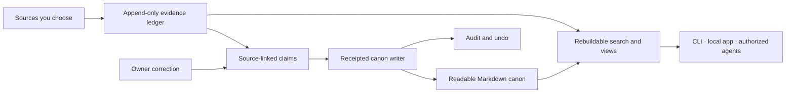

<div align="center">

# Kizuki

### Durable, evidence-backed memory for the agents you choose.

Local-first · source-linked · reversible · harness-neutral

[Start here](#quick-start) · [How it works](#how-it-works) · [Use with agents](#use-with-agents) · [Data and safety](#your-data-and-boundaries) · [Roadmap](#roadmap)

[](LICENSE)
[](https://bun.sh)

</div>

---

Every new agent begins with a partial picture: decisions live in old chats, commitments in messages, and the reason behind a choice in a document no one remembered to attach.

Kizuki keeps selected evidence on your machine and gives each authorized client a bounded, attributable view of it. It is the durable memory layer beneath agents—not another agent harness, chat interface, or cloud memory service.

## What you can do today

- Import selected local files and supported exports; connect approved sources with explicit consent.
- Search retained evidence and compile bounded context packets without a model.
- Keep source-linked claims with provenance, confidence, sensitivity, validity, and correction history.
- Let a configured model write readable Markdown canon through one receipted writer; inspect and undo every write.
- Explore source-anchored **Concept** and **Situation** cards through the CLI, local app, MCP, or loopback HTTP when a model and extraction consent are configured.

The current source revision is 1.0.2. Some connection paths are implemented but have not received live-account qualification; the [connection guide](docs/connect.md) names their coverage and limits.

## Quick start

**Requirements:** Git and Bun 1.3.14. Kizuki runs from a source checkout on macOS and Linux; its release package is an unsigned Linux x64 build and it is not published to npm.

Clone the repository, install dependencies, and open the private local app:

```bash
git clone https://github.com/Illuminfti/kizuki
cd kizuki
bun install --frozen-lockfile
bun packages/cli/src/main.ts app
```

Or try a complete local, model-free flow. This creates a temporary vault, explicitly grants capture of a folder you own, then searches it and builds a session packet:

```bash
demo="$(mktemp -d)"
demo="$(cd "$demo" && pwd -P)"
mkdir "$demo/notes"
printf '%s\n' '# Project Atlas' 'Mira leads Project Atlas.' > "$demo/notes/atlas.md"

cat > "$demo/policy.json" <<'JSON'
{"purposes":["capture","recall","session","derive"],"allowed_fields":["text","subjects","attachments","metadata"],"retention":"persistent_owned_until_revoked","egress":"local_only","sensitivity_floor":"private"}
JSON
chmod 600 "$demo/policy.json"

bun packages/cli/src/main.ts init "$demo/vault" --no-default --no-service
bun packages/cli/src/main.ts import markdown-folder --source "$demo/notes" --policy "$demo/policy.json" --expected-revision 0 --operation-id demo-import --vault "$demo/vault"
bun packages/cli/src/main.ts query "Atlas" --vault "$demo/vault"
bun packages/cli/src/main.ts context --purpose session --query "Atlas" --vault "$demo/vault"
bun packages/cli/src/main.ts doctor --vault "$demo/vault"
```

Importing records evidence; it does not write canon. Without a configured model, `doctor` reports that canon writing is off. That is expected—the search, context, audit, and undo paths remain usable.

For every command and its machine-readable output, see the [CLI reference](docs/cli.md). For the guided local workflow, see the [local app guide](docs/local-app.md).

## How it works

Kizuki separates what happened from what it currently believes, what it writes for people, and what it serves to clients.



**Evidence stays attributable.** Connectors provide a frozen event envelope; source identity, times, subjects, and content hashes remain attached to the owned ledger.

**Understanding can change.** Claims retain support, authority, confidence, sensitivity, validity, and lifecycle. An owner correction outranks an inference, and corrections are receipted and reversible.

**Canon stays yours.** Kizuki writes ordinary Markdown in your vault through one writer. Capture never writes pages directly. You can inspect a receipt with `kizuki audit` and reverse it with `kizuki undo`.

**Derived layers are disposable.** Search, retrieval, and projections can be rebuilt from authoritative state. A model is never required for the deterministic floor.

Read the [architecture](docs/architecture.md), [binding autonomous-canon RFC](rfcs/0002-autonomous-canon.md), and [current direction](docs/CURRENT.md) for the full contract.

## Use with agents

Kizuki owns memory and policy; your preferred client owns its agent loop. The stdio MCP adapter gives an enrolled identity only the data its grant permits:

```bash
bun packages/mcp/src/bin.ts \
  --vault /absolute/path/to/vault \
  --token-ref file:/absolute/path/to/agent.credential
```

For local owner use, replace the credential flag with `--owner`. For an environment-held credential, use `--token-env VARIABLE_NAME`; tokens never belong on the command line.

The adapter exposes reads such as `search`, `get_page`, `timeline`, `context_packet`, `graph_neighbors`, `system_health`, and `world_view`, plus `propose` and `correct`. It does not expose unrestricted page writes. The core enforces identity, grants, scopes, sensitivity ceilings, allowlists, rate limits, and audit below the prompt layer.

To give Codex, Claude Code, or another command-running harness a compact session packet, use the shipped hook:

```bash
bun packages/cli/src/main.ts hook session-start --harness codex --direct
```

The hook is bounded and silent on failure, so a missing vault or denied credential cannot break the host session. [Integration recipes →](docs/integrations.md)

### World views

When extraction is configured and permitted for a source, discover Concepts and Situations with `kizuki world`:

```bash
bun packages/cli/src/main.ts world --operation find_concepts --label "Atlas" --vault /absolute/path/to/vault
```

Each result carries evidence, confidence, uncertainty, and coverage. Empty or partial results are explicit; they are not evidence that the underlying world is complete. World Slice, World Diff, revision resume, outcomes, attention, forecasts, and Atlas remain roadmap work.

### Optional history tree

Kizuki can also present authorized conversation history as a bounded, read-only tree. It is a deterministic extractive view for navigating retained evidence—no model, agent reset, or automatic client-history compression is involved.

```bash
bun packages/cli/src/main.ts history --connector kizuki.import-chatgpt --budget 1024 --vault /absolute/path/to/vault
```

The result names a `snapshot` and child `node` references. Pass both back with the same filters to zoom into one branch; a leaf points to the existing timeline expansion for the original event. The view covers the first 200 authorized matching events, so use time filters to navigate later history. It is rebuilt and re-authorized on every read, so an old or foreign snapshot fails after a purge, revocation, policy change, or scope change. It needs captured evidence and the existing timeline grant; it never exposes a semantic summary as if it were source text.

## Connect sources

Start with `kizuki connect --list` for the live catalog and `kizuki connect status` for enrollment and sync state. Capture begins only after an explicit source-consent grant.

Kizuki supports local Markdown, selected exports, offline Screenpipe ingestion, coding-session transcripts, and several account connectors. Provider setup, what is retained, and qualification limits vary: use [connection setup and limits](docs/connect.md) before enrolling an account.

## Your data and boundaries

- **Local custody:** authoritative state and readable canon live in your vault.
- **Explicit egress:** runtime network access is limited to configured connectors and model endpoints; Kizuki has no required hosted service or telemetry.
- **Consent before capture:** credentials do not authorize use of data. Sources need separate, revisable grants with a declared policy.
- **Fail closed:** missing identity, grant, scope, sensitivity, or provenance never becomes access. Captured content is data, never trusted instruction.
- **Readable exit:** audit, undo, export, restore, and purge support ownership and recovery.

Kizuki does not encrypt your vault or canon. Anyone who can read the host files can read the data. See the [security model](SECURITY.md) and [source-consent contract](docs/cli.md#source-consent).

## Roadmap

Kizuki’s direction is a richer personal world model: broader typed understanding, task-bounded World Slices, world revisions and diffs, outcome learning, and incremental Atlas views. These are design and roadmap items, not claims about today’s release.

The [world-model program guide](docs/world-model-program.md) connects accepted contracts and proof requirements. [Issue #497](https://github.com/Illuminfti/kizuki/issues/497) is the historical execution map for the 1.0 program; [CURRENT.md](docs/CURRENT.md) is the binding statement of what this revision runs.

## Contribute

Kizuki is a TypeScript/Bun modular monolith. Before opening a change, read [AGENTS.md](AGENTS.md), the [contribution guide](CONTRIBUTING.md), and the relevant architecture or RFC.

Run the full repository verification gate from the checkout root:

```bash
bun run verify
```

For a source connector, implement `kizuki.connector/v1`, emit `kizuki.event/v1`, and pass the shared conformance suite. Do not claim a provider path works until its public contract and tests exist.

## Credits

[Beacon](https://github.com/Asymptote-Labs/agent-beacon) informed the agent-run evidence-capture seam. Kizuki's [local Beacon importer](docs/beacon-import.md) reads selected snapshots; Beacon is not installed or bundled.

The hybrid retrieval recipe and entity-graph walk are a permitted fork of [GBrain](https://github.com/garrytan/gbrain) at public commit `8c70f6255047a7647adb30b1d6333a48068d9fa5`, vendored under `packages/retrieval-pg/vendor/`. It is not a registry dependency. Rerank and local GGUF remain Kizuki's own work. [Upstream policy and attribution →](docs/upstream-policy.md)

## License

[MIT](LICENSE). Free local forever; recall is never metered.
